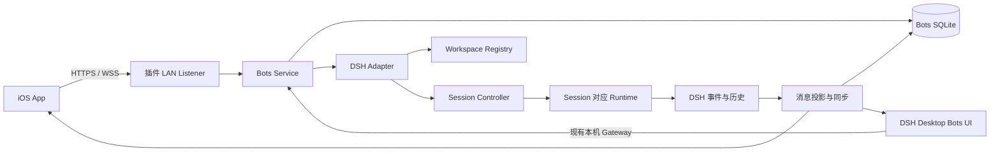

# dsh-bots：局域网聊天助理 MVP 计划与代码设计

日期：2026-10-22。本文保留 MVP 的产品与架构设计基线；本 `dsh-bots` 仓库已实现本次约定的非 iOS 范围：共享协议、持久化业务层、DSH Host 插件、桌面聊天、助理管理与 iOS 邀请二维码；本期不增加浏览器客户端。后续按用户明确要求新增了 `apps/ios` 原生客户端；实现与验证状态见 [iOS 开发说明](ios.md)。Android 仍不实现。宿主基于 DSH `dsh-v0.2.0-rc.2` 与 `dsh-embedded-codex`。

下文保留的接口名、目录与移动端细节属于设计参考；实际命令、数据结构及路由以 [共享协议](protocol.md) 和 [LAN API](lan-api.md) 为准。已执行的验证及尚待完成的跨平台、同 Wi-Fi/热点和移动真机验证见 [README](../README.md)。

## 1. 产品定义与关键决策

DSH Bots 是 DSH 的移动聊天入口：用户在手机上与具名助理单聊，也可以让多位真人和多个助理加入同一个群聊。助理在桌面所选的已有 Session 及其 Workspace 中完成工作，执行过程与结果回传到对应聊天，群成员在手机和桌面共享同一条时间线。

参考 Grok Bot 的聊天列表、具名助理、群聊、@提及、任务过程和结果展示。Grok Bot 官方说明将手机和桌面的 Bot、会话及执行环境连接起来，群聊支持提及其他 Bot；DSH Bots 的执行环境采用用户自己的 DSH 电脑。[Grok Bot 移动端说明](https://docs.x.ai/grok-bot/mobile)、[产品概述](https://docs.x.ai/grok-bot/overview)。

建议直接采用以下决策：

| 项目 | MVP 决策 |
|---|---|
| 仓库 | 独立 monorepo：桌面插件、协议、领域逻辑、iOS 工程一起版本管理 |
| 桌面交付 | 一个可安装的 `dsh-bots` Bundle，同时提供 Host 服务、嵌入 DSH 的单聊/群聊客户端和聊天邀请入口 |
| 移动端 | 原生 SwiftUI，建议最低 iOS 18；实际 SDK/Xcode 版本在立项时锁定 |
| Android | 本期不写客户端；共享线协议、测试数据与设计 token 为后续准备 |
| 通信 | 局域网 HTTPS + WSS；聊天二维码直连，自动监听和端口选择 |
| 数据中心 | 当前连接的电脑是聊天数据的权威节点；手机保存缓存、草稿与待发送消息 |
| 执行引擎 | 复用 DSH Session Controller 和当前 Session 的 Agent Runtime |
| 助理绑定 | 创建助理时选择一个已有 Session；该 Session 同时只能绑定一个聊天 |
| 模型凭据 | 保留在电脑端，手机无需独立配置模型 API key |
| 群聊范围 | MVP 支持多位真人 + 多个助理；真人具有独立身份，同一真人可以使用多台设备 |
| 身份与成员管理 | MVP 包含 Host 本地身份、邀请、加入/退出/移除成员及权限；不依赖云账号 |
| 群聊上下文 | 非 @ 真人消息作为背景上下文注入群内助理；不单独唤醒空闲助理或创建任务 |
| 任务回传 | 流式回复、过程消息、工具摘要、执行状态、交互卡片和最终结果回到对应聊天 |
| 在线范围 | 一次连接一台电脑，一个聊天室归属于一台电脑；可记住多台电脑后切换 |

多位真人群聊和非 @ 消息上下文注入已确认进入 MVP。每个群仍归属一台 Host；所有参与者的设备直接连接这台电脑，不要求每位成员各自运行 DSH。MVP 建议采用“加入后可看完整群历史”的规则，邀请页明确告知；群主身份不自动赋予电脑的管理权限。

局域网仅限定手机与电脑的连接方式。电脑上的模型、联网搜索、远程工具仍可能需要互联网；完全离线需要另外配置可离线运行的模型和工具。

## 2. MVP 边界

### 必须完成

- 桌面端开启手机连接，生成配对二维码，查看与撤销已配对设备。
- 多位真人通过邀请加入同一个群；支持独立成员身份、同一成员多设备、退出/移除成员与群权限校验。
- 同 Wi-Fi 下连接；验证手机热点和电脑热点两种方向，发现失败时支持二维码中的地址直连。
- 创建助理时选择已有 DSH Session；Host 从 Session 确定工作区并校验授权，沿用其预设、模型和权限。
- 创建、编辑、停用具名助理；创建页面仅配置名称、头像和已有 Session。
- 单聊和群聊都通过结构化 @助理调用对应 Session。单聊输入框默认选中本助理，可移除标签改为仅投递上下文；群聊默认不选中助理。
- 群内非 @ 真人消息同步到各端，并通过 DSH 的上下文注入能力进入各助理对应 Session；空闲时不启动任务，运行中在 Runtime 支持的后续接收点生效。
- 文本、Markdown、代码块、回复引用；流式文本、运行状态、工具摘要及完成结果。
- 手机与桌面 Bots 聊天视图双向同步；已绑定 DSH 原生 Session 中新增的用户消息与助理输出也同步。
- 消息落盘确认、去重、离线待发、断线补发、重连恢复、未读状态。
- 停止当前执行、取消尚未执行的任务、查看错误及明确重试。
- 当前 Runtime 发起的人类问题和审批可以在手机处理；桌面与手机共享同一个决策结果。
- 安装、卸载、升级、数据库迁移，以及 Windows/macOS Host 与 iPhone 真机联调。

### 后续版本

| 功能 | 建议阶段 | 原因 |
|---|---|---|
| 图片、文件上传和结果文件下载 | MVP 后第一批 | 需要上传凭证、文件可见范围、体积限制和预览能力 |
| 分享扩展、语音输入增强 | P1 | 不影响文字任务闭环 |
| Android | P1/P2 | 可复用协议与测试数据，独立实现客户端 |
| 锁屏系统推送 | P1 | 需要 APNs 与联网通知路径 |
| 跨公网访问、云中继 | P2 | 引入远程发现、服务运维及新的信任边界 |
| 多电脑参与同一群 | P2 | 需要跨 Host 路由、数据归属与故障策略 |
| 助理自动互相 @、自主协作 | P2 | 需要循环限制、预算和明确任务所有权 |
| 自动日程、远程桌面视频、插件市场 | P2 | 超出本期聊天与 Session 控制闭环 |

### iOS 通知承诺

| 手机状态 | MVP 行为 |
|---|---|
| App 在前台且电脑可达 | 双向实时消息与流式输出 |
| 短暂切后台 | 尽力完成已开始的数据提交，不承诺持续在线 |
| 长时间后台、锁屏或被系统挂起 | 电脑继续执行并保存结果；回到 App 后补齐 |
| App 被用户结束 | 下次打开后恢复连接并补齐 |
| 电脑睡眠、关机或 DSH 退出 | 显示离线；执行是否中断由电脑上的 DSH 状态决定 |

普通 iOS App 不能依赖长期后台 WebSocket 接收任意局域网事件。后台刷新和持续后台任务也不构成通用即时通信保活机制，因此 MVP 不承诺锁屏实时系统通知。[Apple：iOS Background Execution Limits](https://developer.apple.com/forums/thread/685525)。

后续可用 APNs 通知结果到达；推送仅携带事件标识或最少摘要，聊天正文仍从电脑读取。手机离开局域网时，即使收到通知也可能暂时取不到正文。通知服务与聊天内容中继应作为两项独立功能设计。

## 3. 核心用户流程与界面

首次本机使用：Host 所有者安装插件 → 创建助理并选择已有 Session → 进入聊天。连接手机时再开启局域网、扫码配对；无需预先开放整个 Workspace。所需 Session 先在 DSH 中创建，Bots 不再自动创建 Session。

群聊使用：创建群 → 加入助理并设置可调用成员 → 生成邀请 → 其他真人扫码加入 → 普通聊天同步并注入助理背景上下文 → 需要执行时选择结构化 @助理 → 显示各助理的独立执行状态 → 过程与结果按助理身份进入同一个时间线。非 @ 消息不创建 Invocation，也不唤醒空闲模型；已经执行的任务可以在后续接收点读到这些新背景。

受邀成员使用自己的 Person 身份和设备凭据，不复用 Host 所有者的手机凭据。加入群不会自动获得任意 Workspace、已有私聊或原生 Session 的访问权；可见历史与可调用助理由该群的授权决定。

iOS 主导航建议为“聊天 / 助理 / 设备”，设置放在设备页或个人入口。聊天列表优先显示未读、运行中和待回复状态，不用单独任务中心取代聊天。

| 页面 | 主要内容 |
|---|---|
| 聊天列表 | 置顶、单聊/群聊、最后消息、未读、任务状态、搜索本地历史 |
| 聊天详情 | 消息时间线、@输入、回复引用、连接状态、任务卡片、停止按钮 |
| 聊天信息 | 真人/助理成员、邀请、退出/移除成员、调用权限、当前电脑、各助理绑定及群历史可见规则 |
| 助理列表 | 名称、头像、绑定的 Session、可用状态 |
| 创建助理 | 名称、头像、已有 Session；不提供工作区或预设选择、配置摘要和“在 DSH 中打开”入口 |
| 手机设备页 | 已记住的电脑、连接/离线、重新发现、重新扫码、移除信任 |
| 桌面 Bots 页面 | 聊天列表、单聊、多人群聊、成员/邀请管理、@助理、流式回复、执行状态、停止任务、提问与审批、助理管理、打开原生 Session |
| 聊天邀请弹窗 | 输入框内打开，显示 iOS 二维码、有效期、复制、刷新和撤销；自动处理 HTTPS/WSS 监听 |

桌面聊天、助理和聊天邀请都属于 `dsh-bots` 插件。安装同一个插件后，在现有 DSH 内增加 Bots 聊天入口和输入框内的邀请二维码；桌面 Bots 页面就是嵌入 DSH 的桌面聊天客户端，支持本期范围内的单聊和多位真人群聊。桌面以 Host 所有者身份参与，受邀真人从各自手机加入；手机与桌面读写同一 Host 上的聊天数据，新增消息同步给所有有权限的在线成员。

桌面直接复用 DSH 的 ConversationSessionHeader 和原生 Tab：标题仅显示激活聊天的名称，未选聊天以及管理页面留空；一级 Tab 仅为聊天、助理。聊天横栏直接采用轨迹“时长／轮次／调用”按钮的 CSS module，保持 32px 栏高、20px 按钮高度；头像加文字，选中灰色矩形、未选中透明，群聊最多叠放三位成员。输入使用原生 DraftEditor 与 InputBar 样式，房间草稿和提交路由由 Bots 持有。消息按 Binding + Turn 归组，用户气泡、整轮用时、过程分组、最终回复及复制操作复用原生组件；不再将每个工具和中间输出作为独立助理消息展示。不同 Session 的数据由 Bots 归并，不能将一个原生 Session 页面直接作为整个群聊。

新建单聊默认显示所绑定 Session 的可见历史；群聊单独选择是否导入旧消息。旧聊天保留原有截止位置。创建助理直接复用 DSH 原生 @ 候选菜单、样式和键盘交互，绑定适配层提供所有工作区的已有 Session，不创建临时 Session 或修改原生草稿。删除工作区白名单、单独 Session 授权和连接 Tab。输入框邀请按钮首次生成二维码时自动开启 HTTPS/WSS，优先 49210 或上次端口，占用后自动选择可用端口；二维码由未来 iOS 客户端消费，不增加浏览器加入页。

Bots 聊天页负责组织聊天室和多个助理；DSH 原生 Session 页负责展示某个助理对应会话的详细执行轨迹与工具调用。一个 Bots 群聊可以关联多个助理的独立 Session，用户可从助理或任务入口跳转到对应原生 Session。

视觉上沿用 Grok Bot 的信息组织和聊天交互，采用 DSH 的品牌、色彩、圆角、间距与状态表达。桌面复用 DSH 的 `ui-theme` 与 `--dsw-*` token；iOS 将需要的语义 token 映射到 `DSHTheme`，例如背景层级、主次文字、强调色、边框与运行状态。

第一版创建助理只选择已有 Session，不额外配置职责、Preset、权限或模型。执行配置沿用原 Session，不隐式切换 Runtime。历史数据中已保存的职责及版本仍可保留用于原有任务记录。

长消息折叠、代码横向滚动、动态字体、VoiceOver、键盘避让、中文输入和滚动位置保持列入 MVP 验收。先用 SwiftUI 实现列表；只有真机性能证据表明不够时，才局部改用 UIKit 消息列表。

## 4. 总体架构



Host 在现有 DSH Desktop 进程所管理的插件树中运行。新增 LAN Listener 与桌面本机 Gateway 使用不同监听面；手机只接触 Bots API，业务层直接使用已注入的 DSH 服务。

当前 DSH WebServer 使用 `node:http`，配置只支持 loopback 或 all-interfaces。因此建议在 Bots 插件内部建立专用 `node:https` 监听器，只开放所需路由，监听用户选定的本地网卡地址。启用、关闭、HMR、卸载和 DSH 退出都通过 Cordis effect 清理监听器、订阅和连接。

独立监听器不等于独立执行服务：不另外启动一个读取相同 Session 存储的 DSH 进程，也不通过第二个 Agent Runtime 接管已有 Session。执行仍由原 Host 拥有。

电脑不在线时，手机可以看缓存、写草稿和保存待发消息；无法启动电脑中的 Agent。MVP 不提供公网转发或自动端口映射。

## 5. 技术栈

| 层次 | 推荐实现 | 选择依据 |
|---|---|---|
| Host 语言与构建 | TypeScript、ESM、pnpm、tsdown；版本对齐目标 DSH | 与现有插件开发和打包方式一致 |
| 插件框架 | Cordis Bundle + 可释放 effects | 复用 DSH 的服务注入与生命周期 |
| 局域网 HTTP | Node `https` + 明确的少量路由 | 避免为本期少量接口引入完整 Web 框架 |
| 实时通道 | `ws`，客户端标准 WebSocket | 一条连接承载命令响应与实时事件 |
| 发现 | Host `bonjour-service`；iOS `NWBrowser` | 使用 DNS-SD，保留二维码地址直连 |
| 身份与证书 | Node WebCrypto、`@peculiar/x509`、iOS Security/Keychain | 证书生成与标准 TLS，不自创加密协议 |
| Host 数据库 | 独立 SQLite 数据库、`node:sqlite`、SQL migration | 需要事务、唯一索引和 outbox；当前 DSH 也使用该驱动 |
| 桌面 UI | React，版本跟随 DSH；复用现有客户端组件与 theme | 保持 UI 与宿主兼容 |
| 线协议 | JSON Schema 为源，生成 TS/Swift DTO，维护跨端样例 | 将业务 API 与 DSH 内部类型隔离 |
| iOS | Swift 6、SwiftUI、async/await、actor | 本期聚焦 iOS，便于网络、生命周期和证书处理 |
| iOS 网络 | `URLSession` + `URLSessionWebSocketTask` | 标准 HTTPS/WSS 与认证委托 |
| iOS 本地数据 | GRDB/SQLite | 事务保存事件、游标、草稿和待发消息 |
| 测试 | Vitest、真实 Cordis Loader 集成测试、Swift Testing/XCTest、XCUITest | 覆盖业务、真实插件组合和真机生命周期 |
| 发布 | 插件 tgz + 兼容性 manifest；iOS TestFlight | 分开安装，协议版本协商 |

选用 SwiftUI 是基于“本期只做 iOS”的工程判断。React Native 能分享部分 UI/业务代码，但局域网发现、证书信任和生命周期仍需要原生集成。如果确定紧接着投入 Android 且团队以 React Native 为主，可在 P0 前替换客户端实现；Host、协议与领域模型保持一致。

依赖版本在 P0 针对目标 DSH、Electron 所带 Node 和 Xcode 锁定，不以最新 Node 文档作为宿主能力保证。已有 DSH 使用 `node:sqlite` 可作为可行性依据，但插件仍要在实际发行版运行时做 smoke test。GRDB 通过 Swift Package Manager 引入。[Node SQLite](https://nodejs.org/api/sqlite.html)、[GRDB](https://github.com/groue/GRDB.swift)、[ws](https://github.com/websockets/ws)、[bonjour-service](https://github.com/onlxltd/bonjour-service)、[X.509 库](https://github.com/peculiarventures/x509)。

## 6. 仓库与模块设计

```text
dsh-bots/
  packages/
    protocol/
      schema/                  # 线协议和版本描述，唯一规范源
      generated/ts/
      fixtures/                # Swift/TS 共用的消息与错误样例
    core/
      src/model/               # Person、Device、Bot、Room、Binding、Message、Invocation
      src/chat/                # 发消息、成员、引用、未读
      src/identity/            # Host 本地人员、设备归属、邀请与成员权限
      src/routing/             # 结构化 mention 与调用分配
      src/context/             # 非唤醒注入、投递对账、上下文范围与职责版本
      src/sync/                # room journal、snapshot、游标
      src/store/               # SQL、事务、migration、outbox
    dsh-plugin/                # 发布包名 dsh-bots
      src/index.ts             # Cordis 插件入口
      src/adapter/             # 唯一依赖 DSH Session 内部类型的位置
      src/lan/                 # TLS、HTTP、WebSocket、限流
      src/invitations/         # 聊天邀请、成员身份、凭据与撤销
      src/network/             # 局域网候选地址、自动端口、TLS
      src/interactions/        # 人类问题与审批适配
      cordis.patch.yml
      package.json
    desktop-ui/                # 随插件交付，嵌入现有 DSH 的桌面客户端
      src/chats/               # 桌面单聊与群聊
      src/bots/
      src/devices/             # 手机配对、连接状态、授权与撤销
  apps/
    ios/
      DSHBots.xcodeproj
      DSHBots/App/
      DSHBots/Features/{Chats,Bots,Devices,Pairing}/
      DSHBots/Networking/
      DSHBots/Persistence/
      DSHBots/DesignSystem/
      DSHBots/Generated/
      DSHBotsTests/
      DSHBotsUITests/
    android/README.md          # 本期仅记范围与协议接入方式
  tests/
    integration/               # 使用真实 dsh profile/Loader
    protocol/
    recovery/
  tooling/                     # 生成协议、打包、安装、兼容性检查
  docs/
  pnpm-workspace.yaml
```

先只发布一个 `dsh-bots` npm 包，其他 TS workspace 可保持 private 并在构建时打入交付物。`core` 不依赖 Cordis、React、Swift 或模型厂商；`protocol` 不导出 DSH 私有类型。`packages/desktop-ui` 是插件内部的代码与构建分包，其 client bundle 与 Host 服务一起交付，通过 DSH 的插件机制加载；不单独开发或安装另一款 Electron 桌面应用。`apps/ios` 则构建为单独安装的手机 App。

Bundle 只插入 Bots 所需配置项，不替换 Agent Registry、Session Controller 或模型循环。开发和交付沿用 `dsh` profile 启动及插件安装方式；不新增绕过宿主的生产 CLI。

## 7. 领域模型与数据所有权

```typescript
type Id = string;

interface Person {
  id: Id;
  hostId: Id;
  displayName: string;
  hostRole: "owner" | "member";
}

interface Device {
  id: Id;
  hostId: Id;
  personId: Id;
  revokedAt?: string;
}

interface Bot {
  id: Id;
  name: string;
  avatar: string;
  sessionId?: Id; // 新建助理必填；旧助理需选择或从唯一已有绑定迁移
  instructions: string;
  instructionsVersion: number;
  defaultPresetId?: string; // 历史兼容字段，不用来修改已有 Session
  defaultWorkspaceId: Id; // 从所选 Session 推导
  enabled: boolean;
}

interface Room {
  id: Id;
  hostId: Id;
  kind: "direct" | "group";
  title: string;
  historyVisibility: "full";
  revision: number;
}

interface RoomMember {
  roomId: Id;
  subject: { kind: "person" | "bot"; id: Id };
  role: "owner" | "member";
  joinedAtRoomSeq: number;
  leftAtRoomSeq?: number;
}

interface BindingGrant {
  bindingId: Id;
  personId: Id;
  canInvoke: boolean;
}

interface BotBinding {
  id: Id;
  roomId: Id;
  botId: Id;
  hostId: Id;
  workspaceId: Id;
  sessionId: Id;
  generation: number;
  publishFromSessionSeq: number;
  lastContextScannedRoomSeq: number;
  active: boolean;
}

type MessagePart =
  | { type: "text"; text: string }
  | { type: "mention"; botId: Id; label: string };

interface SendMessage {
  clientMessageId: Id;
  roomId: Id;
  parts: MessagePart[];
  replyToMessageId?: Id;
}

interface Invocation {
  id: Id;
  messageId: Id;
  bindingId: Id;
  bindingGeneration: number;
  initiatedByPersonId: Id;
  initiatedByDeviceId: Id;
  requestId: string;
  triggerRoomSeq: number;
  status: "queued" | "dispatching" | "accepted" | "running"
    | "waiting_user" | "completed" | "failed" | "cancelled"
    | "interrupted" | "recovery_required";
}

interface ContextDelivery {
  id: Id;
  bindingId: Id;
  bindingGeneration: number;
  roomMessageId: Id;
  roomSeq: number;
  dshMessageId: Id;
  status: "pending" | "accepted" | "consumed" | "discarded" | "omitted"
    | "recovery_required";
}
```

这些是拟议领域类型，并非现有 DSH API 的复制。持久化类型增加时间、来源、修订号和索引；创建助理允许提交从已有可用会话列表选中的 `sessionId`，Host 必须校验真实归属、是否存在及是否已被占用，无需工作区或单独 Session 授权。其他消息请求不接受任意 Session 目标、文件系统路径或自报的用户身份。

必须保持以下关系：

1. 一个 Host 上的一个 active Session 只属于一个 active BotBinding；一个 Room 中一个 Bot 只有一个 active Binding。
2. Bot 创建时选定已有 Session；加入聊天时复用该 Session。如果已绑定其他聊天，拒绝重复绑定，不自动创建或复制会话。
3. Workspace 与 Session 的真实归属由 Host 校验，不能相信手机提交的路径或缓存。
4. 已有绑定时不直接更换助理的 Session；先解除绑定再选择其他已有 Session，保留旧消息与来源关系。第一版不提供自动创建新 Session 的重置入口。
5. 绑定已有 Session 时选择“从现在开始展示”或明确导入历史。群聊不自动公开旧历史；即使不展示，原 Session 的模型上下文仍可能包含旧内容，界面必须说明。
6. 删除聊天或解除绑定默认保留 DSH Session；删除底层 Session 是单独的显式操作。
7. 同一 Session 在 DSH 原生界面仍可查看和对话；它不是另一份被复制的 Session。
8. 一个 Device 只归属一个 Person；成员关系和已读归属于 Person，传输游标及待发幂等键归属于 Device。显示名称不承担身份认证。
9. `direct` 是一位真人与一个助理的私聊；`group` 支持多位真人与多个助理，群主必须是真人。新成员按明确的完整群历史规则加入，移除后不能继续读取或订阅。
10. 邀请加入后自动取得该聊天助理的 `BindingGrant`；后续显式撤销保持有效。只有 Host 所有者可调整调用能力或修改 Session 绑定，群主不能扩大电脑权限。

推荐 SQL 表：`hosts`、`people`、`devices`、`device_credentials`、`room_invites`、`bots`、`rooms`、`room_members`、`bot_bindings`、`binding_grants`、`messages`、`invocations`、`dispatch_outbox`、`context_deliveries`、`room_events`、`session_projection_cursors`、`read_cursors`、`device_sync_cursors`、`pending_interactions`。

| 约束/索引 | 作用 |
|---|---|
| `UNIQUE(device_id, client_message_id)` | 手机重发同一消息时返回原结果 |
| 上述请求同时保存 canonical payload hash | 相同幂等键但内容不同返回冲突，不静默复用 |
| `UNIQUE(room_id, seq)` | 每个 Room 的持久事件有稳定排序 |
| `UNIQUE(message_id, binding_id)` | 一次消息对一个助理只产生一次调用 |
| `UNIQUE(binding_id, binding_generation, room_message_id)` | 同一群消息对同代 Binding 只建一个上下文投递记录 |
| active member 的 `(room_id, subject_kind, subject_id)` 唯一索引 | 防止同一真人或助理重复加入 |
| `UNIQUE(person_id, room_id)` 的 read cursor | 同一真人多设备共享已读进度，更新只前进 |
| `UNIQUE(device_id, room_id)` 的 sync cursor | 每台设备独立补齐，另一台 ACK 不跳过本机未收消息 |
| active binding 的 `(host_id, session_id)` 唯一索引 | 防止一个 Session 被多个聊天重复公开 |
| active binding 的 `(room_id, bot_id)` 唯一索引 | 防止同一助理重复绑定 |
| `UNIQUE(host_id, session_id, source_seq, projection_kind)` | 重放 DSH 事件时不重复生成聊天项 |

Bots SQLite 保存聊天与派发状态；DSH 仍保存 Session、工具执行和模型历史。聊天中的执行消息是 DSH 事件的投影，保存来源指针，不另造一份执行历史。数据库位置由 DSH home/path 服务确定，在插件专有数据目录下存放，不绑定进程 cwd。

使用短事务、预编译 SQL 和有界查询；写入消息、分配 Room seq、创建所需 Invocation/outbox 或 ContextDelivery 在同一个事务完成。上下文扫描游标只表示已建立投递记录，是否进入 DSH inbox、是否被模型消费由独立投递状态确认。同步驱动不处理大文件和高频逐 token 落盘；超出目标规模再考虑 Worker。

## 8. @路由、群上下文与任务回传

| 输入 | 路由行为 |
|---|---|
| 单聊普通消息 | 有结构化 @ 时调用对应 Binding；移除默认 @ 后只投递上下文 |
| 群聊普通真人消息 | 保存、同步，向群内各 active Binding 投递背景上下文；不创建 Invocation，不唤醒空闲助理 |
| 群聊 @A | 只为 A 创建 Invocation；对其他助理作为群背景投递 |
| 群聊 @A @B | 为 A、B 分别创建 Invocation；不再给 A、B 重复注入本条任务文本 |
| @所有助理 | 接受消息时展开为当前有权限的成员列表并保存 |
| 助理输出文本中出现 @B | 按普通内容显示，不自动启动 B；其持久正文可在其他助理下一次显式调用时作为背景 |
| 回复引用但未 @ | 单聊和群聊都只注入背景，不隐式推断执行目标 |

输入框生成结构化 mention part，Host 以 `botId` 校验当前群成员与发送者的调用权限，不用正则匹配显示名称。这样改名、重复名字、中文和 emoji 都不会改变路由。给真人的回复或展示性提及不进入助理调用路由。

### 非 @ 消息注入

每条符合范围的真人群消息落盘后，为群内各 active Binding 创建持久 `ContextDelivery`。发送者必须仍有发言权限，目标助理仍在群内且绑定有效。通过 DSH 的 `Agent.inject(UserMessage)` 进入该助理 Session 的上下文输入队列，内容使用明确的“群聊背景”格式，带 Room、Person ID、显示名、消息 ID、Room seq 和引用来源；不把群成员的文字冒充系统指令或当前任务发起人的直接命令。

| 助理状态 | 背景消息何时生效 |
|---|---|
| Agent 已激活但空闲 | 注入 next-step inbox，等待下一次显式调用或 Runtime 自身的合法唤醒；普通聊天本身不启动模型 |
| Agent 正在执行 | 在后续可接收输入的步骤生效；已经发出的模型请求不能被回溯修改，也不承诺当前 token 立刻受影响 |
| Session 尚未激活或 Runtime 不可用 | 先保留 Bots 投递记录；通过宿主恢复原 Session 后补投，不能另建执行服务或使用普通 prompt 假装注入 |

对目标助理的 @消息由正常任务输入提交一次，不重复作为该助理的背景注入。其他助理的持久回复可在下次显式调用时补充为上下文，但不把每个流式 token、工具日志或其他助理的回复实时互相注入，避免相互持续延长正在执行的任务。

MVP 默认启用群背景注入，允许短时间合并投递，按 Room seq 保留发言顺序。每批限制消息数、字节和估算 token；大量积压只补入近期窗口与显式引用，未投递的超限记录标为 `omitted` 并保存省略区间，不能无限增长 inbox。被选入模型输入的内容和职责版本在投递前冻结；重试使用原内容。群历史始终完整保存在 Bots，DSH 的上下文压缩继续由原 Runtime 管理。

派发 @任务之前，先确认同一 Binding 中早于 `triggerRoomSeq`、仍获授权且被选入当前上下文窗口的背景已经进入 DSH inbox 或输入历史，再提交任务 prompt；显式引用在此时补齐，并避免重复已经投递的内容。存在不确定投递时先进入恢复状态，任务不能抢先越过背景队列。背景注入和任务提交共用宿主的 Session 操作串行化，但不把整段模型执行持有在操作锁内；较晚到达的普通消息仍可在任务运行期间注入。

为每个 Invocation 固定 `triggerRoomSeq`，记录本次 @发生在群时间线的哪个位置；为每个背景投递保存独立来源和 DSH 消息 ID。同一条多 @消息具有相同的触发位置，但各 Session 已有历史及实时注入的消费时机可能不同，不承诺整个执行期间具有相同或冻结的上下文。需要明确先后关系时，用户再次 @并引用对应结果。

### 投递确认与恢复

`ContextDelivery accepted` 表示已进入 DSH 的持久 inbox，`consumed` 表示对应 `user/message` 已记录到模型输入历史；两者都不同于创建任务或任务完成。`Agent.inject()` 本身没有 `SessionPromptRequest.requestId` 的自动去重保证：adapter 必须在同一 Session 操作队列内，用稳定 `dshMessageId` 核对持久 inbox、认领/取消记录和已消费消息，再决定补投。不能只凭一次方法返回就假设模型已经读取。

重启后已接受但尚未消费的注入不重复添加；取消或销毁丢弃的输入标为 `discarded`，仅在下次显式任务需要该背景时重新评估。若存在已认领但无法确认实际消费的窗口，保留恢复状态并停止自动重投，不能重复唤醒或静默丢失确认记录。普通消息及其投递记录先落 Bots 事务，跨库状态由来源 ID 对账。

### 任务消息回传

任务会回传到发起它的单聊或群聊，不要求用户打开原生 Session 才能看结果。一个 Invocation 对应一张任务卡片和可关联的助理消息，保留发起人、助理、原请求、Binding generation 与 Session/turn 来源；群内所有当前有权成员收到同一条持久时间线。

| DSH 中的内容 | 聊天中的展示 |
|---|---|
| 排队、开始、运行、等待用户、完成、失败、取消 | 更新同一任务卡片的状态 |
| 助理对用户可见的过程文本与最终回复 | 以该助理身份流式显示，持久结果替换临时内容 |
| 工具执行和后台任务的已发布进度/结果 | 展示工具名称、必要摘要和结果；详细记录可从桌面打开原生 Session |
| 人类问题与审批请求 | 展示交互卡片；只有有回答权限的成员可操作，其余看到等待/已处理状态 |
| 电脑端直接继续已绑定 Session | 标记为来自电脑的任务或消息，同步其后续执行和结果 |

回传使用 Session 的事件与 assistant-stream 投影，按来源去重；不将内部控制事件或全部原始工具日志直接作为聊天正文。后台任务与子任务以宿主实际发布到绑定 Session 的可见消息/事件为准；独立子 Session 的全部日志不是 MVP 的默认订阅范围。结果文件本身的下载仍按附件能力排到后续版本，文本结果、文件说明与路径展示属于 MVP。手机离线时结果保存在 Host，重新连接后补齐。

同一 Binding 一次只派发一个 Bots Invocation，其余保留在 Bots 队列。不同 Workspace 可并行；同 Workspace 的 Bots 写入任务默认串行。这个调度范围不包含用户从 DSH 原生界面另开的任务：MVP 必须显示这种并行活动，允许暂停 Bots 调度，不宣称已经提供全局文件写隔离。统一写锁或独立 worktree 是后续扩展。

## 9. 对接现有 DSH 的方式

已从当前源码核实的能力：

| 现有能力 | 代码位置 | Bots 用法 |
|---|---|---|
| `SessionCreateRequest` | [session types](../upstream/deepseek-harness/packages/api/session-controller/src/types.ts) | Bots 只用已验证的 `workspaceId` 和已有 `sessionId` 恢复会话，不指定 `agentPreset` 或分配新 ID |
| `SessionPromptRequest` | 同上 | `requestId`、`sessionId`、`mode: queue/steer`、content |
| prompt 去重 | [session commands](../upstream/deepseek-harness/packages/api/session-controller/src/commands.ts) | 已检查 inbox 与持久 `user/message` 的 rpcId |
| `create/prompt/cancel/page/follow` | [Session Controller](../upstream/deepseek-harness/packages/api/session-controller/src/index.ts) | 通过宿主 service 调用，避免自建模型执行循环 |
| `Agent.inject(UserMessage)` | [Agent Runtime API](../upstream/deepseek-harness/packages/core/agent/src/runtime-types.ts)、[AgentLoop 实现](../upstream/deepseek-harness/packages/core/agent-loop/src/agent.ts)、[Embedded Codex 实现](../src/agent.ts) | 将群背景放入 next-step inbox，`wakeup=false`；不创建普通任务 |
| 持久 inbox 与输入记录 | [AgentLoop inbox](../upstream/deepseek-harness/packages/core/agent-loop/src/inbox.ts)、[Embedded Codex inbox](../src/inbox.ts) | 区分已排队、被认领、被丢弃与已进入 `user/message`，用于注入对账 |
| Workspace 稳定身份与归属验证 | [Workspace types](../upstream/deepseek-harness/packages/workspace/workspace/src/types.ts) | 用 ID 选择目录并验证 Session cwd |
| follow snapshot + event + assistant-stream | [history](../upstream/deepseek-harness/packages/api/session-controller/src/history.ts) | 历史、持久事件和临时流式帧分别适配 |
| Runtime 路由与 Session 操作串行化 | [当前适配架构](architecture.md)、[coordinator](../src/compat/session-coordinator.ts) | 与 `embedded-codex` 共存，不绕过已有协调器 |
| 审批与问题 | [user-approval](../upstream/deepseek-harness/packages/interaction/user-approval/README.md)、[user-questions](../upstream/deepseek-harness/packages/interaction/user-questions/README.md) | 通过已有决策链和 Remote Events 适配 |

特别注意：当前 `follow()` 提供 opening snapshot 和后续事件，接口并没有一个可直接填入的 Bots `afterSeq` 字段。Bots 自己维护 Room journal 与重连游标；DSH 投影恢复使用 snapshot 的 cutoff、分页补读以及来源 seq 去重，不能伪造现有 API。

当前 `SessionPromptRequest.mode` 只有 `queue/steer`，Session Controller 没有公开的非唤醒 `inject` 方法。Bots 的上下文 adapter 应在宿主内取得已有 Agent 的受控引用并调用 `inject()`；若获取/恢复和串行化能力没有公开接缝，P0 给宿主补最小的非唤醒投递接口，复用原有生命周期与 Runtime 路由。不能把普通群消息改成 `prompt(mode: "queue")` 或 `steer()`，这两种操作都会允许唤醒。标准 AgentLoop 在后续 step 领取背景，当前 Embedded Codex 对运行中输入通过其 steering 桥转交；两种 Runtime 的实际接收时机分别验证。

`DshAdapter` 是计划新增的内部接口，具体 DSH 类型转换集中在适配层：

```typescript
interface DshAdapter {
  capabilities(): Promise<RuntimeCapabilities>;
  listAuthorizedWorkspaces(principal: AuthenticatedPrincipal): Promise<WorkspaceSummary[]>;
  ensureBindingSession(binding: BotBinding): Promise<void>;
  injectContext(input: {
    sessionId: string;
    bindingGeneration: number;
    deliveryId: string;
    dshMessageId: string;
    content: readonly PromptPart[];
  }): Promise<{ accepted: true }>; // 新增 adapter 操作，不是现有 Controller RPC
  inspectContext(sessionId: string, dshMessageId: string): Promise<ContextObservation>;
  submit(input: {
    sessionId: string;
    requestId: string;
    prompt: readonly PromptPart[];
    mode: "queue";
  }): Promise<{ accepted: true }>;
  observe(sessionId: string, signal: AbortSignal): AsyncIterable<NormalizedDshFrame>;
  inspectRequest(sessionId: string, requestId: string): Promise<RequestObservation>;
  cancelInvocation(input: {
    invocationId: string;
    expectedBindingGeneration: number;
  }): Promise<CancelOutcome>;
  answerInteraction(input: InteractionAnswer): Promise<InteractionOutcome>;
}
```

`AuthenticatedPrincipal`、`ContextObservation`、`RuntimeCapabilities`、`NormalizedDshFrame` 等也是待实现的内部类型。principal 由 Host 根据已认证设备解析，包含 Person 与 Device 身份；Runtime capabilities 必须声明非唤醒注入和运行中输入的支持情况。不把所有 Runtime 假设成相同模型、工具或权限系统。支持范围先锁定目标 DSH 与当前 Embedded Codex 组合；其他版本通过兼容性检查拒绝启动或明确降级，不能静默把“注入”变成“执行任务”。

创建助理时验证已有 Session，并从它推导 Workspace。建立聊天 Binding 时先持久化未激活记录，再通过 DSH Host 恢复选中的 Session，确认返回 ID 与所选 ID 一致后才激活；不分配新的 Session，不修改原有 Preset、模型或权限。Host 同时检查工作区授权及是否已被其他聊天绑定。

### 审批与提问

移动端应成为现有交互仲裁的另一个参与端。P0 核实 Gateway Remote Events 的参与者接入与首个有效回答规则；若现有公开接口不足，给 DSH 补一个最小参与者接缝，再实现 Bots adapter。不能仅增加一个抢先返回的 `approval/request` waterfall listener，让桌面与手机各自持有互不相知的审批。

每个回答携带 request ID、Session ID、Binding generation 和当前请求版本，回答人的 Person/Device 身份由认证连接推导；Host 验证请求仍待回答、回答人有权限，并只接受一次。普通任务澄清由任务发起人或 Host 所有者回答；涉及电脑资源与工具权限的审批，MVP 仅允许 Host 所有者处理，群主不自动具有审批权。桌面先回答后，其他手机的旧卡片更新为已处理；过期、取消、撤销权限或重启后失效的请求不能继续接受。

当前标准 DSH 的 `approval=never` 会拒绝需要审批的请求，并非自动批准。Embedded Codex 的权限组合由其 Runtime profile 解释。Bots 显示有效策略并转交真实请求，不把同名字符串重新定义，也不扩大 Workspace 授权。

### 取消语义

当前 DSH `cancel()` 取消活动执行并保留待处理 inbox。因此产品区分“停止当前执行”和“取消排队任务”。Bots 停止操作必须先确认该 Invocation 仍对应当前活动输入/turn；若 Session 已执行到后一个任务，拒绝旧取消命令，不能误停它。尚未派发的任务只修改 Bots 队列；已进入 DSH 队列的任务通过真实队列项身份移除。

## 10. 可靠消息、断线恢复与双向同步

发送流程：

```text
iOS 本地事务：写 pending message
  → WSS message.send（稳定 clientMessageId）
  → Host 校验 Person/Device、成员身份、Room、Binding、授权与 payload
  → Host SQLite 事务：message + Room event + 按目标创建 Invocation/outbox 或 ContextDelivery
  → message.accepted（此时代表聊天已保存）
  → 执行分支：固定任务 prompt，调用 DSH prompt，记录任务接收状态
  → 背景分支：固定引用内容，调用 DSH Agent.inject，记录上下文接收状态
  → DSH Session 事件：关联输入、turn、输出和交互
  → projector：更新聊天项 + journal + source cursor
  → 所有有权限的成员手机与桌面同步显示
```

`message.accepted`、`Invocation accepted` 和 `completed` 是三种事实。网络断开时丢失 ACK 不等于消息没执行，客户端重发原 ID；显式“重新执行”才创建新 Invocation 并标明重试来源。

没有执行目标的普通群消息返回 `invocationIds: []`，其背景投递使用 ContextDelivery 状态，不制造排队/运行的任务卡片。多人并发发言统一由 Host 分配 Room seq；服务器将认证身份写入消息作者，不能用客户端传来的显示名判定发送人。所有投递与后续实时广播均检查当前成员资格。

派发器采用持久 outbox。简化伪代码如下，所有网络/DSH 调用都在数据库事务外：

```typescript
async function dispatch(invocationId: string) {
  const job = store.claimDispatch(invocationId); // 本地短事务 + 有期限的 claim
  if (!job) return;
  await authorization.recheck(job);             // 使用当前授权，不只信任入队时检查
  const prior = await dsh.inspectRequest(job.sessionId, job.requestId);
  if (prior.kind === "observed") {
    store.reconcileDispatch(job, prior);
    return;
  }
  if (prior.kind === "unknown-after-crash") {
    store.requireRecovery(job);                // 不盲目重做可能已产生外部副作用的任务
    return;
  }
  await contexts.ensureReadyBefore(job);        // 确认触发消息之前选入的背景已投递
  await authorization.recheck(job);             // 等待背景期间权限可能已变化
  await dsh.submit({
    sessionId: job.sessionId,
    requestId: job.requestId,
    prompt: job.frozenPrompt,
    mode: "queue",
  });
  store.markAccepted(job);                      // 后续 Session 事件确认实际执行进度
}
```

目标是可重试传输和幂等接收，不承诺任意模型工具副作用的全局 exactly-once。Host 在派发后崩溃时，先查询 DSH inbox/日志中的 request ID；有明确记录则对账，已确认未派发才继续派发，存在无法判断的副作用窗口则显示恢复所需状态。

桌面原生 Session 的新增消息也由同一 projector 导入 Room：带 Bots request ID 的用户消息回填原聊天项；带上下文投递身份的 `user/message` 只确认 ContextDelivery，不再生成一条真人消息；没有 Bots 来源的真实用户输入作为 Host 所有者“来自电脑”的消息导入。插件来源的其他上下文不会被当成人类发言。导入与重放只是投影，不再进入 @路由器或再次注入原 Session。

手机离线时 Host 仍持续投影已绑定 Session。重新启动插件时从持久的 DSH seq 恢复，而不是只依赖启动后才会出现的 live event。DSH 历史的 durable cutoff 与恢复结果以宿主为准，不将暂存 token 当作已经持久提交的模型结果。

### 游标与重连

- 每个 Room 有递增的持久 `seq`；TS/Swift 线协议限制在双方精确表示的整数范围内。
- 手机在一个数据库事务内应用事件并保存 `lastAppliedSeq`，提交后再发送 ACK。
- ACK 与补发按 Device/Room 保存；已读按 Person/Room 单调更新并同步该人的设备，不能让一位成员已读清掉其他成员的未读。
- 重连以最后成功提交的游标请求补齐。服务器事件保留窗不足时返回 `snapshot_required`。
- snapshot 包含同一一致性 cutoff 下的 Room 状态、消息窗口和游标；后续只发大于 cutoff 的事件，避免 snapshot 与订阅之间丢消息。
- 历史消息分页与实时事件补发分开；消息表可保留完整聊天，journal 可做有界清理。
- `hostId` 与持久 `storeEpoch` 标识数据集。普通重启保留 epoch；从备份恢复或重建数据集后更换 epoch，客户端旧游标失效并重新快照。
- Room 被撤销访问时清理服务端订阅，客户端收到撤销后隐藏对应数据；离线设备中的已下载副本无法保证即时远程擦除。

### 流式内容

持久 journal 保存最终消息、运行状态与必要进度；token delta 属于临时帧，携带 `invocationId`、`attemptId`、`streamRevision`、`index`。它们不占用持久 Room seq，也不推动持久 ACK。

重连先拿当前 active stream snapshot，再继续对应 index。旧 attempt、重复帧和乱序帧不拼接到新消息；发现缺口重新请求当前输出快照。最终持久消息按同一显示项身份替换流式草稿。Token 合并以约 30–60 ms 为初始调优值，慢客户端超出缓冲上限后断开并用游标恢复。

## 11. 对外协议草案

采用 `/bots/v1` 命名空间。HTTPS 负责配对、引导快照和历史分页；WSS 负责实时命令、事件和状态。协议在建立连接后交换 major/minor、Host 版本、Runtime 能力、storeEpoch、支持的消息类型和上限。

| 路由 | 用途 |
|---|---|
| `POST /bots/v1/invites/redeem` | 原子兑换群邀请，建立/关联真人身份、绑定设备并加入指定群 |
| `POST /bots/v1/auth/refresh` | 轮换设备凭据并获得短期访问令牌 |
| `GET /bots/v1/bootstrap` | 当前 Person、Device、可访问 Room/Bot、版本能力；完整 Session/Workspace 目录仅本机所有者可见 |
| `GET /bots/v1/rooms/{id}/messages` | 按游标分页取聊天历史 |
| `GET /bots/v1/rooms/{id}/snapshot` | 一致性快照，附 cutoff 与可续订信息 |
| `GET /bots/v1/stream` | 经过认证的 WebSocket Upgrade |

核心命令包括 `message.send`、`room.create`、`room.update`、`room.delete`、`room.owner.transfer`、`room.invite.create`、`room.invite.revoke`、`room.leave`、`room.member.remove`、`binding.grant.update`、`bot.create`、`bot.update`、`bot.delete`、`binding.create`、`invocation.cancel`、`interaction.answer`、`sync.resume`、`sync.ack`、`read.update`。服务端从凭据推导设备与真人身份，重新检查所有资源权限。`message.send` 按是否存在助理目标自动选择任务或背景路径，客户端不能自行指定任意 Session 的注入目标。

```json
{
  "version": 1,
  "kind": "command",
  "id": "cmd_01",
  "type": "message.send",
  "payload": {
    "clientMessageId": "client_message_01",
    "roomId": "room_01",
    "parts": [
      { "type": "mention", "botId": "bot_dev", "label": "开发助理" },
      { "type": "text", "text": "检查这个 Workspace 的测试失败原因" }
    ]
  }
}
```

```json
{
  "version": 1,
  "kind": "event",
  "roomId": "room_01",
  "seq": 42,
  "type": "message.accepted",
  "payload": {
    "messageId": "message_01",
    "clientMessageId": "client_message_01",
    "invocationIds": ["invocation_01"]
  }
}
```

命令响应通过 `replyTo` 关联 command ID；同一持久事件广播到所有有权限的端。服务端事件包括 `room.member.changed`、`room.access.revoked`、`message.created/updated`、`invocation.updated`、`interaction.updated` 和 `read.updated`；消息事件携带 Host 验证的作者身份，任务事件携带发起人和助理身份。命令 ID 与业务幂等键分开，重连重发可使用新 command ID 和原 clientMessageId。

建议错误码：`UNAUTHORIZED`、`DEVICE_REVOKED`、`PERSON_REVOKED`、`INVITE_EXPIRED`、`INVITE_REVOKED`、`NOT_ROOM_MEMBER`、`FORBIDDEN_BOT`、`ROOM_NOT_FOUND`、`BOT_NOT_MEMBER`、`SESSION_ALREADY_BOUND`、`BINDING_STALE`、`RUNTIME_UNAVAILABLE`、`CONTEXT_INJECTION_UNSUPPORTED`、`IDEMPOTENCY_CONFLICT`、`INVOCATION_NOT_CURRENT`、`INTERACTION_FORBIDDEN`、`INTERACTION_EXPIRED`、`SNAPSHOT_REQUIRED`、`PROTOCOL_UNSUPPORTED`、`RATE_LIMITED`。

错误同时包含是否可重试和需要刷新哪些资源。协议 major 不兼容拒绝连接；新增可选字段由 minor 演进，未认识的展示内容显示通用卡片，未认识的命令不能假装执行成功。Schema、生成产物和跨端 round-trip fixtures 在同一次提交更新。

## 12. 聊天邀请、局域网与授权

### 本地身份与聊天邀请

Host 初次启用建立本机所有者 Person；其他成员使用独立身份，昵称不用于认领已有账号。删除单独的设备配对流程，不发放远端 Host 所有者凭据。

1. 在任意聊天输入框点击邀请，Host 自动启动独立 HTTPS/WSS 服务。默认不监听；首次邀请后保存启用状态和端口，重启恢复。
2. 生成绑定 roomId 的高熵邀请，有效期 10 分钟，同一码允许多人加入。刷新使旧码失效，关闭弹窗不影响连接。
3. 二维码内容是 `dshbots://invite?data=…`，带协议、Host ID、storeEpoch、局域网候选地址、实际端口、证书指纹、邀请和到期时间。
4. iOS 验证指定 Host 的 TLS 指纹后，通过 HTTPS 兑换；凭据不进入 URL 或日志。新成员默认可查看完整聊天历史并调用聊天里的助理。
5. 同一兑换请求通过 requestId 与 deviceChallenge 恢复响应；已有登录设备通过 bearer 保留身份和成员关系，不恢复显式拒绝的调用权限。客户端同步保存轮换后的凭据。
6. 首位新成员加入单聊时，事务内转为群聊，保留 ID、历史、绑定和截止位置。移除成员后拒绝该群的新读取与任务，并使当前邀请失效。
7. 未来 iOS 将凭据放入 Keychain；Host 保存验证材料。邀请只赋予目标聊天访问，不能枚举全部工作区、原生 Session 或扩大 DSH 的执行权限。

TLS 继续使用持久 P-256 身份及证书指纹。`@peculiar/x509` 生成证书，Node TLS/iOS 定向信任负责握手。私钥保留在 Host 私有目录，不进入二维码和插件包。iOS 信任、扫码、局域网权限及真机双向聊天留待客户端完成后联调。

### iOS 连接实现

iOS 根据二维码中的候选地址连接 HTTPS/WSS，无需 Bonjour 发现。后续实现时处理局域网访问权限、定向证书信任、凭据存储和断线恢复。当前仅交付桌面邀请与后端协议；不创建 iOS 或浏览器客户端。

同 Wi-Fi 不保证设备互通：访客网络的客户端隔离、防火墙、VPN、多网卡与热点策略都可能阻断连接。地址直连能绕过发现失败，不能绕过网络隔离。诊断界面区分局域网权限拒绝、找不到服务、TCP 不通、证书不匹配、设备已撤销和协议版本不兼容。

MVP 以 IPv4 同网段与热点为发布验收主路径，接口和地址模型保留 IPv6；不把 Apple 专有近场通信作为连接 Windows 电脑的基础。

### 授权范围

设备认证只确定“哪位真人的哪台设备”，实际操作同时检查 Person、Room 成员关系、Binding 调用授权和设备是否被撤销。列举、历史、实时订阅、发消息、背景注入、执行取消和交互回答都在 Host 检查权限，手机隐藏入口不能替代检查。受邀成员可以调用获授权的群助理，但不能因此枚举任意 Workspace、读取原生 Session 或操作本机文件。移动协议不开放任意 shell、插件安装、原始 Gateway RPC 或任意路径读取。

| 操作 | MVP 权限 |
|---|---|
| 查看群历史、发送普通消息、贡献群背景、更新自己的已读 | 当前真人成员 |
| 邀请、移除成员、修改群资料 | 群主或 Host 所有者；群主不能移除 Host 所有者，退出前需转移群主或解散群 |
| @助理创建任务 | 当前成员且拥有该 Binding 的调用授权 |
| 停止/取消任务 | 任务发起人且仍为成员，或 Host 所有者；另需确认任务仍可取消 |
| 回答任务澄清 | 任务发起人且仍为成员，或 Host 所有者 |
| 工具/资源权限审批、授予助理调用能力、修改 Workspace/Session 绑定 | Host 所有者 |

群背景由所有成员共同提供，引用中的文字不是权限授予；任务执行与审批始终按 Host 规则检查。群聊复用助理已选择的 Session；将它公开到多人群之前，Host 所有者必须明确选择共享其已有上下文，不能把“从现在开始展示”当作隐藏旧模型上下文的隔离措施。

任务队列和背景投递队列在执行前重查授权、成员状态、Binding generation 和 Workspace 状态。网络层按 Person、Device 和 Room 限制消息大小、速率、订阅数和排队数；初始容量目标见验收部分，参数由实测调整。

## 13. iOS 代码组织与状态管理

```text
SwiftUI Feature View
  → @MainActor FeatureModel（界面状态、用户意图）
  → ChatRepository / BotRepository / DeviceRepository
  → LocalStore（GRDB，缓存、游标、草稿、pending）
  → HostConnection actor（认证、WSS、恢复、命令相关性）
```

连接状态明确为 `unpaired → discovering → connecting → authenticating → syncing → online`，另有 `offline`、`permissionDenied`、`revoked` 和 `incompatible`。处于 syncing 时可看旧消息，但发送状态不能假装已到达电脑。

连接 actor 每次重连生成 connection generation；旧连接的迟到回调不得更新新连接状态。重试采用有上限的指数退避与抖动，前台恢复或网络变化可立即触发一次连接尝试，随后仍遵守退避。

```swift
actor HostConnection {
    private var generation = UUID()
    private var socket: URLSessionWebSocketTask?

    func connect(to host: TrustedHost) async throws {
        // 取消旧连接和接收任务，建立经过定向信任验证的连接。
        // 完成版本协商，再以已提交的 Room 游标同步。
    }

    func send(_ command: ClientCommand) async throws {
        // 数据库拥有 pending message；连接层拥有帧发送与响应相关性。
    }

    func suspend() async {
        // 尽力完成短提交，保存游标，释放后台不应长期占有的连接。
    }
}
```

这是接口草图，不是可直接编译的实现。`scenePhase` 进入前台时重连并同步，后台时结束短提交并允许连接释放。UI 从数据库观察结果，避免网络回调直接到处修改聊天数组。

手机收到持久事件后先本地事务提交，再更新待发状态和 ACK；缓存与 draft 按 Host/Person/Room 隔离。离线发送显示“待发送”，用户可以撤销；恢复后按原消息 ID 发送，不能静默生成新的任务。若此时已被移除群，显示发送失败并禁止继续同步，不将旧凭据下的待发消息转给其他身份。

开发环境需要 macOS/Xcode 与 iPhone 真机。当前 Windows 工作区可开发 Host、协议和桌面 UI；iOS 构建、签名、TestFlight 及部分网络测试需要 Mac 或 macOS CI。

## 14. 分阶段交付计划

以下为工程估算，假设一位熟悉 DSH/TypeScript 的开发者和一位 iOS 开发者，设计与 QA 有配合。按已确认的多人群聊、身份邀请、背景注入与任务回传范围，约 8–10 周达到可试用 MVP；单人同时承担两端约 12–16 周。估算包含集成与发布，不包含公网、Android 和锁屏即时系统通知，也不是交付承诺。

| 阶段 | 时间参考 | 工作项 | 出口条件 |
|---|---|---|---|
| P0 技术验证 | 3–5 个工作日 | 插件加载、真实 Session 往返、两种 Runtime 的非唤醒注入、iPhone TLS/WSS、发现/热点矩阵、交互仲裁接入 | 普通背景不唤醒空闲助理，@后读到背景并回传任务；明确注入/审批接缝与可支持网络组合 |
| M1 数据、身份与插件骨架 | 第 2–3 周 | protocol、SQL migration、Person/Device/Invite、Bot/Room/Binding、成员/调用授权、DSH adapter、打包安装 | 独立真人凭据加入指定群，消息可持久保存，稳定绑定目标 Workspace |
| M2 单聊纵向闭环 | 第 4 周 | SwiftUI 单聊、嵌入 DSH 的桌面单聊、原生 Session 双向投影、停止、错误展示 | 手机与电脑互发，过程和结果回传，重复请求不重复产生任务 |
| M3 多人群聊与交互 | 第 5–6 周 | 多真人同时在线、邀请/退出/移除、@、多 Binding、背景投递、任务队列、审批/提问、个人已读 | 两位真人与两个助理完成群内任务，背景注入和身份归属正确，多端回答只接受一次 |
| M4 恢复与权限验证 | 第 7–8 周 | 消息/背景双队列对账、snapshot、成员/设备撤销、流式缺口、慢客户端、主题可访问性 | 重连不重复注入或执行，撤销后无继续收发，任务结果正确补齐 |
| M5 试用与发布 | 第 9–10 周缓冲 | Windows/macOS 安装、TestFlight、协议兼容、数据库升级、多人真机体验修正 | 新用户能完成配对、邀请另一人加入群并共同完成任务 |

P0 是技术去风险阶段，不是生产功能集合。如果 TLS/热点、非唤醒注入或交互接缝失败，应先补齐对应能力并调整估算，不能在实现中静默取消已确认的 MVP 范围。

建议按以下顺序拆成可合并任务：协议与错误码 → SQLite 与幂等接收 → 本地身份/邀请/权限 → DSH 执行与注入 adapter → LAN 配对 → iOS 连接/本地存储 → 单聊与任务回传 → 桌面同步 → 多人群聊与背景投递 → 交互卡片 → 恢复与对账 → 打包和发布。每个任务交付一个可演示行为与对应回归证据。

## 15. 验收与测试设计

### 功能验收

| 场景 | 必须观察到的结果 |
|---|---|
| 在现有 DSH 安装同一个 Bots 插件 | 出现桌面单聊/群聊入口和手机连接设置，桌面可发起任务并与手机同步 |
| 创建助理后从聊天发消息 | 选中的已有 Session 接收，真实任务在该 Session 的工作区执行，不自动创建其他 Session |
| 桌面在绑定 Session 追加消息 | 手机显示来自电脑的消息及后续输出 |
| 同一消息重发 10 次 | 一条用户聊天消息，每个目标 Binding 一个 Invocation |
| 两位真人使用各自设备加入同一个群 | 独立 Person 身份、作者归属正确，普通消息与任务结果同步给双方 |
| 同一真人使用两台设备，另有其他成员 | 已读在本人的设备间同步，其他人的未读独立；每台设备各自补齐 |
| 邀请过期、被撤销、被重复兑换 | 拒绝加入，不复用邀请者身份或扩大权限 |
| 空闲群助理收到非 @真人消息 | 背景被记录/投递，不启动模型、不创建 Invocation；下一次 @可读到它 |
| A 发背景后 B 立即 @，此时背景派发尚未完成 | 先完成该 Binding 的前序背景确认，再提交 B 的任务，不因双队列竞态漏掉背景 |
| 群助理运行中收到非 @真人消息 | 在后续可接收点进入上下文，来源和消费记录可查，不另建普通任务 |
| 注入后断线、重启或取消发生在确认窗口 | 已排队/已消费内容不重复注入，丢弃与不确定消费状态被明确处理 |
| 群内 @两个助理 | 两个独立 Session，共享触发消息位置，各自实时背景和执行状态可追溯 |
| 一位成员发起任务，另一位旁观 | 双方看到同一助理的过程、工具摘要、任务状态和最终结果；仅有权成员可操作卡片 |
| 同一 Bot 尝试加入两个 Room | 拒绝重复绑定同一 Session，不自动复制 Session 或共享到第二个聊天 |
| 修改 Workspace/绑定后收到旧命令 | 返回 Binding 已过期，不调用旧或错误 Session |
| 手机断网 30 秒后回来 | 补齐持久消息；流式内容用当前快照恢复 |
| iOS 后台或结束 App | 电脑任务继续；重新打开可对账并显示结果 |
| Host 在派发前后不同位置崩溃 | 消息不丢失；确认状态恢复；不确定副作用明确要求恢复处理 |
| 桌面先答审批、手机后答 | 只执行一次有效决定，手机显示已处理 |
| 普通成员或群主尝试批准工具权限 | 拒绝；MVP 仅 Host 所有者可批准，澄清问题按任务发起人授权 |
| 取消旧任务时 Session 已推进 | 不误停新的任务 |
| 撤销设备或 Workspace 权限 | 现存订阅关闭，新请求拒绝，待派发任务重查失败 |
| 成员退出或被移除后离线重发、恢复订阅 | 不再获得群历史/任务结果，新发言、背景投递和未派发任务拒绝 |
| 已绑定 Session 记录背景 `user/message` | 只确认原 ContextDelivery，不重复显示真人发言、不再次触发助理 |
| 卸载/禁用插件 | 端口、发现广播和订阅释放，DSH 普通 Session 仍可使用 |

### 测试层次

- 单元：mention 路由、真人/设备/成员/调用权限、背景投递范围、任务触发位置、幂等冲突、投影归并、状态转换。
- 数据库与恢复：事务回滚、邀请并发兑换、多人发送排序、注入消费对账、进程杀死后重启、migration、outbox claim 回收、epoch 与设备游标失效。
- 协议：TS/Swift 双向解码 fixtures、未知字段、版本拒绝、非法输入、过大消息。
- 集成：通过真实 DSH profile/Loader 加载发布包，覆盖标准 Runtime 与 Embedded Codex 的空闲注入、运行中接收、取消/恢复及任务回传；外部模型可用受控 fixture，另做真实手工任务验证。
- UI：Swift 状态测试、XCUITest 关键路径、桌面交互测试、至少两位真人/两台手机的群聊、长列表/输入法/前后台测试。
- 网络：Windows/macOS × 同 Wi-Fi/手机热点/电脑热点；权限拒绝、多网卡、IP 变化、防火墙阻断、二维码直连、多地址尝试与端口占用自动恢复。
- 安全行为：伪造 Host 指纹、重放票据、冒用 Person ID、越权邀请/调用/审批、未授权 Room、任意 Session ID、旧设备凭据、跨 Room 订阅、迟到审批回答。

初始容量目标：一个 Host、5 位真人、合计 10 台连接设备（其中一位真人同时连接 3 台）、10 个 Bot、20 个 Room、每 Room 一万条历史消息；首屏按页加载。增加多人连续聊天与多个 Binding 注入的负载用例，验证批量上限和队列背压。它们是测试工作负载，不是已经测得的产品上限。

建议体验目标：健康局域网下聊天落盘 ACK 的 p95 小于 300 ms，已产生的流式输出转发 p95 小于 200 ms，网络恢复后常规增量同步在 5 秒内完成。模型首 token、模型执行时间、大历史全量恢复不计入上述局域网指标。必须在明确设备和网络条件下测量后再写入产品承诺。

## 16. 交付、兼容与运维

插件交付包含构建后的 Host/client bundle、Cordis patch、migration 和兼容性 manifest；manifest 记录支持的 DSH 版本、Embedded Codex 组合、协议 major/minor 和数据库 schema version。开发仓库可以使用固定 DSH checkout 做集成，但发布包不夹带整套 DSH 或另一份模型 Runtime。

iOS 先通过 TestFlight 试用，插件通过本地 tgz 安装到 Desktop profile。安装、升级、回滚与移除遵循目标 DSH 的实际命令，不依赖工作区源码路径；正式命令在实现时由安装 smoke test 验证后写入 README。

数据库迁移在打开 LAN 服务前完成，失败则保持端口关闭并给出可诊断错误。版本升级前备份 Bots 数据；不把旧版本程序强行打开更高 schema 的数据库作为回滚策略。卸载插件默认保留用户聊天数据和 DSH Session，另提供明确的数据清理入口。

记录结构化运行日志：hostId、personId、deviceId、roomId、messageId、invocationId、contextDeliveryId、sessionId、requestId 与错误码；默认不记录消息正文、prompt、token、票据或私钥。提供连接诊断导出时屏蔽个人目录和敏感字段。

监控重点是任务与背景待派发数、最长排队时间、注入确认延迟、成员撤销后的连接清理、重连次数、投影延迟、未恢复请求、数据库失败和流式背压。MVP 使用本机诊断即可，不依赖云监控服务。

## 17. 开工前需要固定的产品假设

目前方案按以下范围闭合：iPhone 优先、Windows/macOS 电脑、多位真人与多个助理群聊、Host 本地独立身份与邀请、非 @真人消息背景注入、@触发任务并回传过程/结果、一次连接一台 Host、正文走局域网、后台依靠恢复补齐、文本任务优先。本地身份与成员权限属于 MVP，不需要先建设云账号或云基础设施。

多人群聊和背景注入已经计入当前排期。仍会扩大范围的调整包括锁屏即时通知、跨公网、多电脑同群、跨 Host 统一账号和附件；这些能力加入 MVP 时需要另行补齐对应协议、授权、测试与发布工作。

最先实施的演示应是：在桌面创建助理并选择已有 Session，iPhone 扫码加入该聊天，发出一条任务，在电脑看到选中的 Session 执行，并在手机收到流式结果；随后断网重连，验证同一任务既不丢失也不重复派发。多人 MVP 的完整演示再邀请第二位真人：A 先发一条不带 @的需求背景，助理保持空闲；B @助理执行，助理读取该背景，过程与结果回到群聊，A、B 和桌面都能看到。
